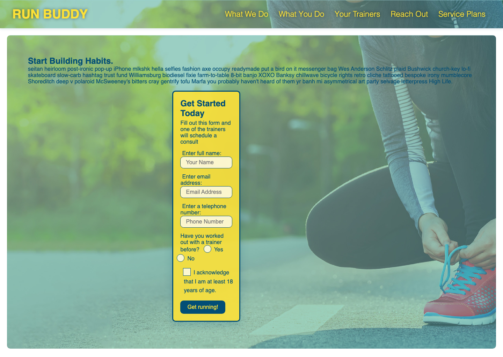

# Run Buddy, Inc

## Purpose

A responsive marketing site for a fitness training service, offering a signup form, an overview of the coaching process, trainer bios, a service plan comparison, and a contact section.

## Built With

* HTML
* CSS

## Website

[https://izabelacloud.github.io/run-buddy/](https://izabelacloud.github.io/run-buddy/)

## Local Setup

This is a static site with no build step or dependencies.

1. Clone the repository
2. Open `index.html` directly in a browser, or serve the folder locally (e.g. `python3 -m http.server`)

## Contribution

Made with love by Izabela Petrovicova

## Questions

If you have any questions about the repository, contact me directly at [i.petrovicova@gmail.com](mailto:i.petrovicova@gmail.com). You can find more of my work at [github.com/izabelacloud](https://github.com/izabelacloud).

### &copy;2019 Run Buddy, Inc
